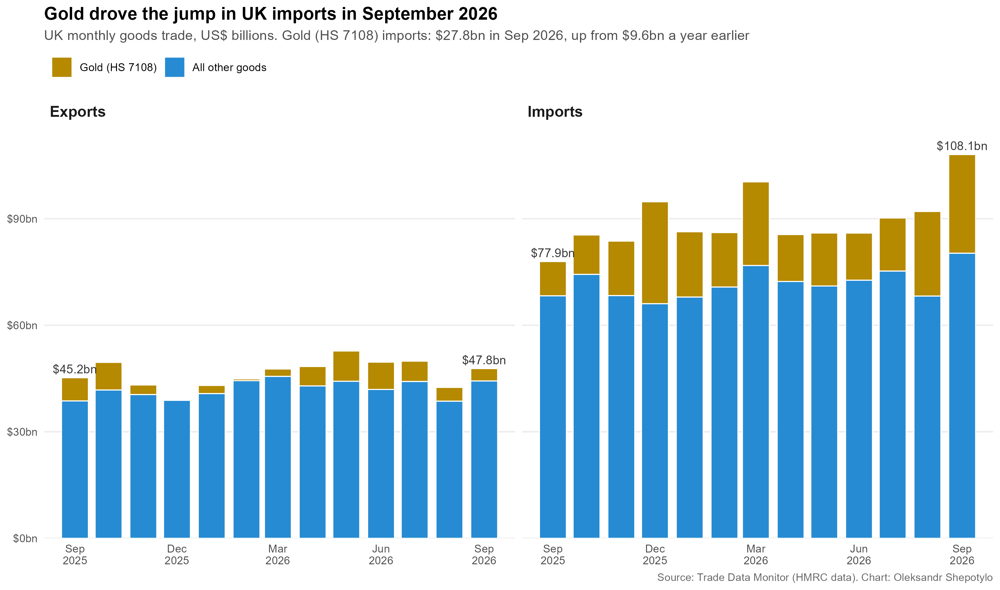
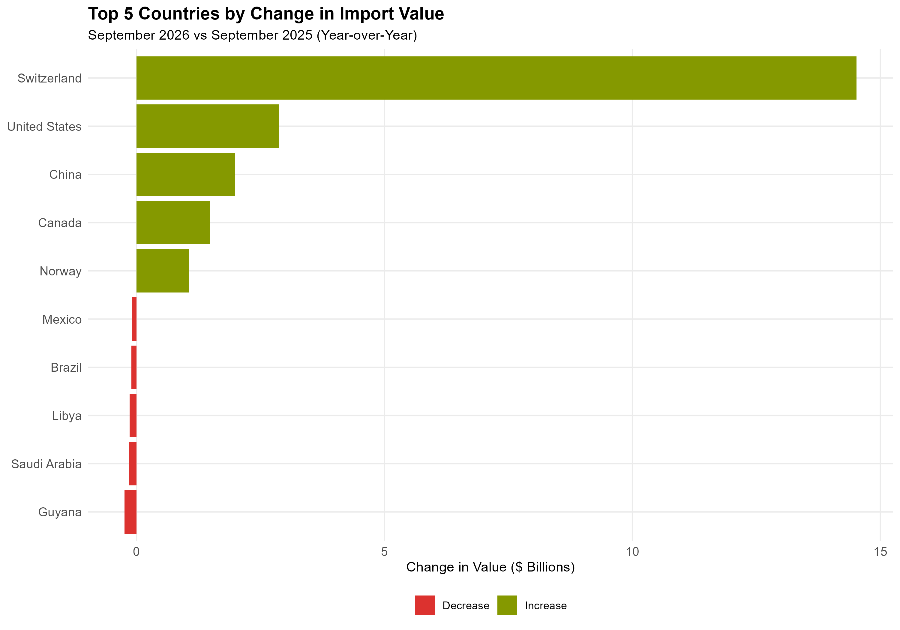
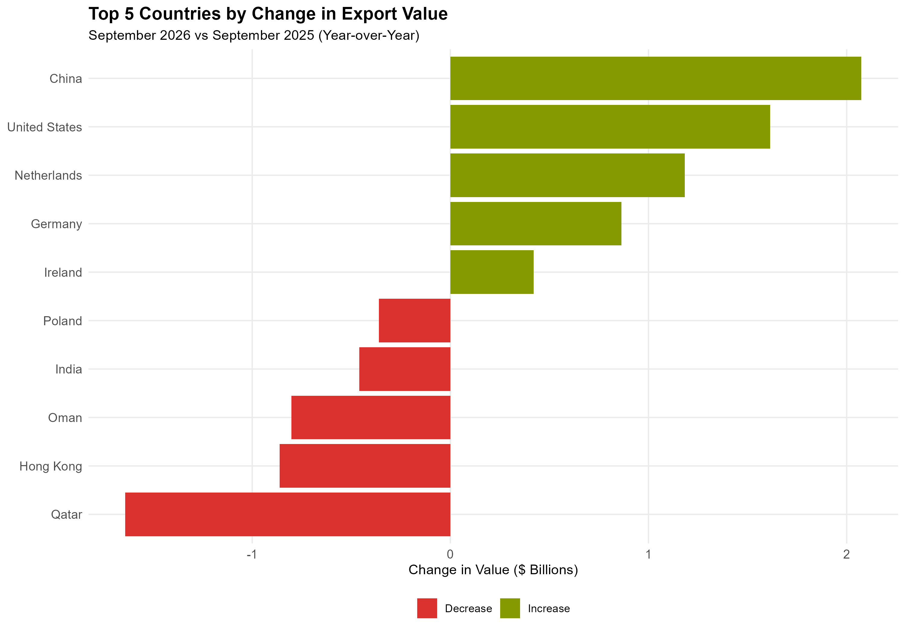

UK goods imports reached **$108.1bn in September 2026**, the highest monthly figure in the past year, and the goods trade deficit widened to **$60.3bn**. Most of the jump came from gold. Strip out gold, though, and the picture is still one of strong growth on both sides of the ledger, with car exports a standout.

## Key takeaways

- **Imports up 17.4% on the month and 38.7% on the year**, to $108.1bn.
- **Gold did most of the lifting.** Non-monetary gold imports were $27.8bn, almost three times the $9.6bn of September 2025. Switzerland alone supplied $15.9bn.
- **The goods deficit widened to $60.3bn**, from $49.5bn in August and $32.7bn a year earlier.
- **Underlying trade still grew strongly.** Excluding gold, exports rose 14.5% and imports 17.6% year on year, and the deficit was $36.0bn, the widest in the past 13 months.
- **Car exports surged.** Exports of mid-size petrol cars nearly doubled on the month and rose more than fivefold on the year, with the US and China as key destinations.

## The headline numbers

| | Sep 2026 | Aug 2026 | Sep 2025 | Change on month | Change on year |
|:--|--:|--:|--:|--:|--:|
| **All goods** | | | | | |
| Exports | $47.8bn | $42.5bn | $45.2bn | +12.5% | +5.7% |
| Imports | $108.1bn | $92.0bn | $77.9bn | +17.4% | +38.7% |
| Trade balance | −$60.3bn | −$49.5bn | −$32.7bn | −$10.7bn | −$27.6bn |
| **Excluding gold (HS 7108)** | | | | | |
| Exports | $44.3bn | $38.6bn | $38.7bn | +14.7% | +14.5% |
| Imports | $80.3bn | $68.2bn | $68.3bn | +17.7% | +17.6% |
| Trade balance | −$36.0bn | −$29.6bn | −$29.6bn | −$6.4bn | −$6.4bn |

: UK goods trade, US$ billions. Source: Trade Data Monitor (HMRC data).

## Gold drives the import surge

{fig-alt="Stacked monthly columns of UK exports and imports from September 2025 to September 2026, split into gold and all other goods. Imports rise to $108.1bn in September 2026, of which $27.8bn is gold."}

*Figure 1. UK monthly goods trade, US$ billions. Gold is non-monetary gold (HS 7108).*

London is the hub of the global gold market, so large volumes of bullion move in and out of the UK for refining, vaulting and trading. These flows are big and volatile and say little about the real economy, which is why the ONS headline trade figures exclude precious metals.

September's gold imports came mainly from **Switzerland ($15.9bn)**, followed by Canada ($3.5bn), the US ($1.9bn), South Africa ($1.6bn) and Uzbekistan ($1.4bn). Silver imports also jumped, to $2.1bn from $0.8bn in August. Gold *exports*, by contrast, fell to $3.5bn, from $6.5bn a year earlier.

Precious metals also explain many of the biggest country-level swings:

- Exports to **Qatar (−$1.6bn), Hong Kong (−$0.9bn) and Oman (−$0.8bn)** fell year on year because large gold shipments in September 2025 were not repeated.
- About half of the **$2.1bn rise in exports to China** was gold.
- Imports from **Singapore** fell by $2.1bn on the month as an August gold shipment dropped out.

{fig-alt="Bar chart of the five import sources with the largest increases and decreases between September 2025 and September 2026. Switzerland leads with an increase of about $14.5bn."}

*Figure 2. Top five increases and decreases in UK imports by source country, September 2026 vs September 2025, US$ billions.*

## Beyond gold: energy, tech and cars

With gold set aside, imports were still up $12bn on the year. Fuels did much of the work. Refined petroleum products rose $1.3bn and crude oil $0.9bn, and imports from **Norway** were up $1.1bn on higher oil and gas deliveries. Computer processing units (+$0.9bn), medicines (+$0.4bn) and smartphones (+$0.4bn) also rose.

On the export side, the standout is **cars**. Exports of petrol cars with 1.5 to 3 litre engines (HS 870323) reached $812m, up from $415m in August and $148m in September 2025. The year-on-year rise partly reflects a low base, since Jaguar Land Rover's production was halted by a cyberattack in September 2025, but the jump on the month shows real momentum. Larger-engine cars added another $267m on the year. The US took an extra $444m of these two car categories, and China an extra $214m.

| Product (HS6) | Flow | Sep 2026 | Sep 2025 | Change |
|:--|:--|--:|--:|--:|
| Gold, semi-manufactured (710813) | Imports | $27,673m | $9,561m | +$18,113m |
| Refined petroleum oils (271019) | Imports | $3,044m | $1,769m | +$1,275m |
| Silver, semi-manufactured (710691) | Imports | $2,148m | $989m | +$1,160m |
| Crude oil (270900) | Imports | $3,016m | $2,164m | +$852m |
| Petrol cars, 1.5–3.0 litre (870323) | Exports | $812m | $148m | +$664m |
| Crude oil (270900) | Exports | $1,455m | $1,032m | +$422m |
| Precious-metal jewellery (711319) | Exports | $635m | $218m | +$418m |
| Petrol cars, over 3.0 litre (870324) | Exports | $657m | $390m | +$267m |
| Gold, semi-manufactured (710813) | Exports | $3,475m | $6,524m | −$3,049m |
| Silver, semi-manufactured (710691) | Exports | $110m | $842m | −$733m |

: Largest product movers, September 2026 vs September 2025, US$ millions.

By destination, exports to the **US rose $1.6bn (+32%)** and to the **Netherlands $1.2bn (+49%)**. The jewellery export jump went almost entirely to Qatar.

{fig-alt="Bar chart of the five export destinations with the largest increases and decreases between September 2025 and September 2026. China, the US and the Netherlands lead the increases; Qatar, Hong Kong and Oman show the largest decreases."}

*Figure 3. Top five increases and decreases in UK exports by destination country, September 2026 vs September 2025, US$ billions.*

## What to watch

- **Gold is a wildcard.** Bullion flows can reverse as quickly as they arrive, so expect large swings in the headline balance over the coming months. The ex-gold series is the better guide to underlying trade.
- **The ex-gold deficit is widening too.** At $36.0bn it is the widest in the past 13 months, driven by fuel and technology imports.
- **Cars are worth tracking.** It is not yet clear whether the September jump marks a sustained recovery in car exports, particularly to the US.

## Data and methods

Data are monthly UK goods trade statistics (HMRC) at the HS 6-digit level, accessed through Trade Data Monitor. All values are in **US dollars**, so changes partly reflect movements in the sterling–dollar exchange rate. "Gold" refers to non-monetary gold, HS heading 7108. Monthly trade data are subject to revision.

The full report, with the top 10 product movers and top 5 partner movers for exports and imports on both a monthly and yearly basis, is available here: [UK Monthly Trade Report, September 2026 (HTML)](UK_Trade_Report_Sep2026.html).
