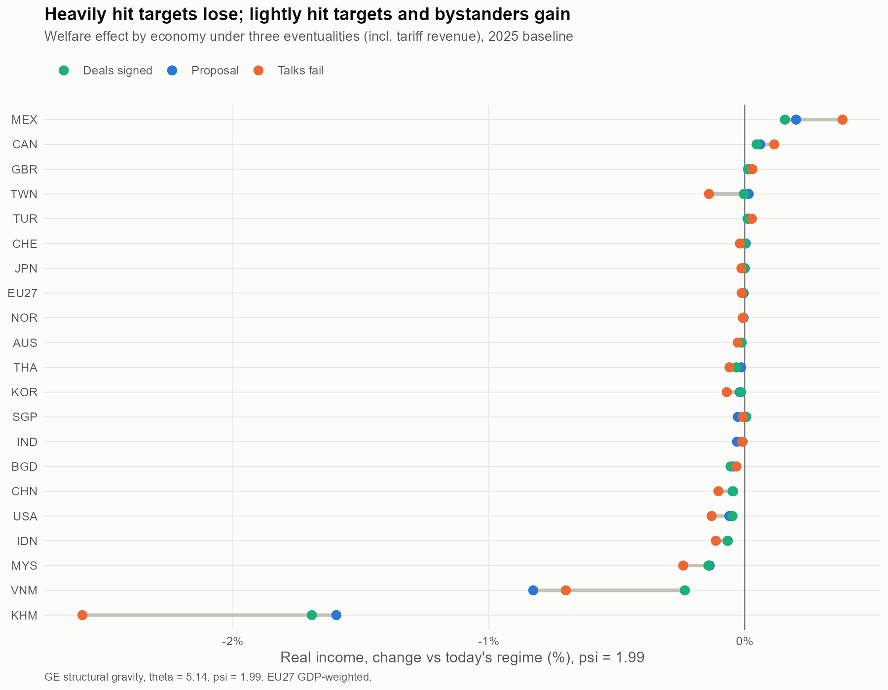
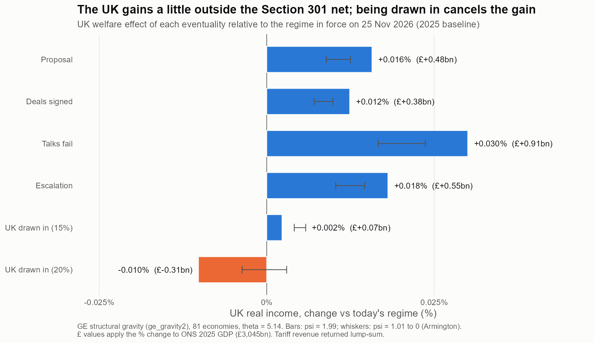
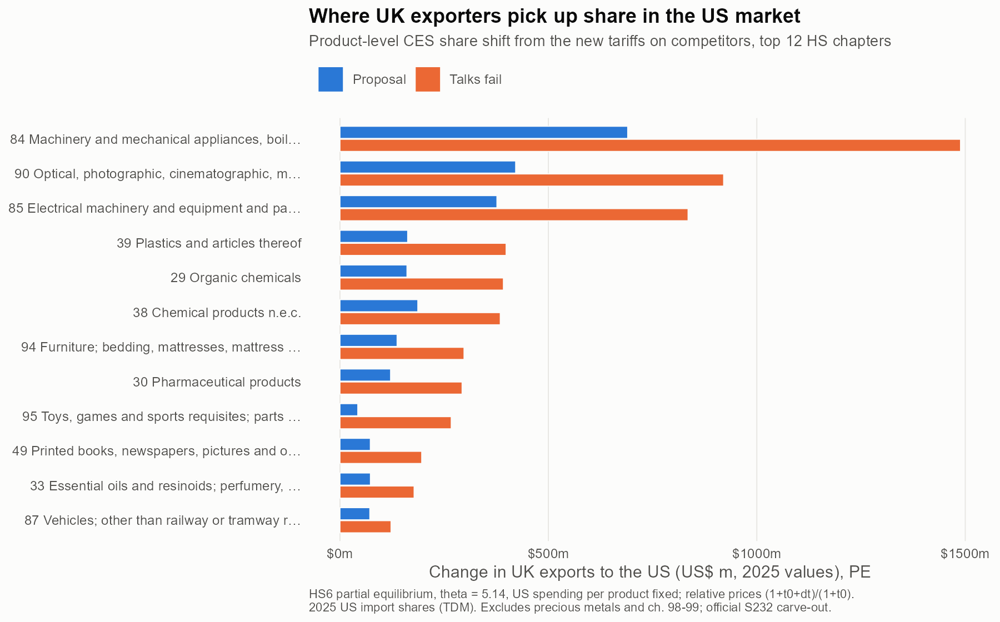

Today USTR proposed country-wide tariffs on 14 economies under Section 301, on the grounds of "structural excess capacity". (My [diary entry](../2026-11-25-trump-trade-war-diary-day-673/index.qmd) covers what is in the notices.) The obvious next question is who gains and who loses. To answer it, I built the proposed tariffs product by product and ran them through a general-equilibrium (GE) trade model of 81 economies. I also ran 5,000 Monte Carlo draws to see how robust the results are.

The short answer:

- **The US loses**, in every scenario.
- **China and the Southeast Asian exporters that replaced it lose most.**
- **The EU roughly breaks even** on income, but more displaced Asian goods head its way.
- **The UK, which is not on the list, gains a little.** That holds only for as long as it stays off the list.

## Key takeaways

- **It is a top-up, not a new wall.** On average the proposal adds **2.3pp** to US import tariffs, mostly on China (+9.7pp) and Vietnam (+9.3pp). The EU gets about +1.6pp, and Japan and Korea less than 1pp.
- **The US loses in every scenario and in all 5,000 model runs.** US real income falls by 0.03–0.06%, even after about **$34bn a year** of extra tariff revenue.
- **China loses 0.03–0.05%**, and about twice that if talks fail and its rate rises to 40%. Vietnam (−0.5% to −0.8%) and Cambodia (−1.0% to −1.6%) lose far more.
- **The EU is roughly unaffected on income.** But it faces **$17–35bn** of goods diverted from the US market, several times more than the UK.
- **The UK gains about £0.3–0.5bn a year (+0.010–0.016%).** UK exports to the US rise by **4.5–6%**. The gain is positive in every model run.
- **The gains are in mid-tech manufacturing:** machinery, scientific and medical instruments, electrical equipment, chemicals and plastics. Cars, steel and most pharmaceuticals are unaffected.
- **The risk is being drawn in.** If the UK were added at 20%, the gain would turn into a loss, and UK exports to the US would fall by about 5%.

## A top-up, not a new wall

The key to the numbers is a detail of the notices: every proposed rate is *net of existing Section 301 duties*. Since 24 July 2026, 60 economies, the UK among them, have paid a forced-labour Section 301 tariff of 10–12.5%. The new action uses exactly the same core exemption list. So for most targets it only **tops up** the duty they already pay to the new headline rate. The UK stays where it is.

Take a product with a 2% MFN tariff that is covered by both actions:

| Exporter | Today | Under the proposal | Gap to the UK |
|:--|--:|--:|--:|
| **United Kingdom** | **12** | **12** | – |
| EU | 10 | 15 | +3 |
| Japan, Korea, Switzerland | 12.5 | 15 | +3 |
| Thailand, Malaysia, Indonesia, Cambodia | 12–14.5 | 20 | +8 |
| China | 14.5 | 22 | +10 |
| India | 12 | 27 | +15 |
| Vietnam | 14.5 | 37 | +25 |

: Total US tariff (MFN + Section 301) on an illustrative covered product with 2% MFN, %. Sources: forced-labour Section 301 tiers (91 FR 47717) and the proposed rates in the USTR notices of 25 November 2026.

**On covered goods, the UK goes from paying 2pp more than EU exporters to paying 3pp less.** Against Asian suppliers, the UK's advantage widens to between 8 and 25 points.

"Covered" is a big qualifier. Almost half of what the US buys from the 14 economies is exempt through the product annex: pharmaceuticals, civil aircraft, energy, smartphones and computers. Cars, steel, aluminium and the other Section 232 goods are also carved out, for every target except China. Only about 41% of these imports face the new rates, which is why the trade-weighted increases are much smaller than the headline rates.

## Winners and losers around the world

{fig-alt="Dot chart of real-income changes by economy for three scenarios: proposal, deals signed and talks fail. Mexico, Canada and the UK gain; Cambodia, Vietnam and Malaysia lose most; the US and China lose in all three scenarios; the EU, Japan and Switzerland are close to zero."}

Where I give a single number below, it is the central calibration. Ranges run from the Monte Carlo median to the central estimate.

### The United States: paying for its own tariffs

The US is the clearest loser.

- **Under the proposal**, US real income falls by **0.03–0.06%**. That is despite about **$34bn a year of extra tariff revenue**: the higher prices US buyers pay for imports outweigh the revenue.
- **If talks fail** and the fallback rates kick in (China at 40%, Korea, Taiwan and ASEAN at 25%), the loss doubles to **0.13%**, even though revenue rises to $52bn.
- **If China and the EU retaliate**, the loss grows to **0.20%**.
- **The US loses in every scenario and in every one of the 5,000 draws.**

The new tariffs mostly re-label duties that the Supreme Court struck down in February. A new legal basis does not change their economics.

### China and its replacements

China loses **0.03–0.05%** of real income under the proposal. If talks fail and the 40% fallback applies to all Chinese goods, the loss rises to **0.08–0.10%**, and to 0.09–0.13% if China retaliates.

But China is not the biggest loser in proportional terms. Between January–May 2024 and January–May 2026, China's share of US imports fell from 12.6% to 7.3%. Over the same period the other twelve targets rose from 26.7% to 36.4%. This is exactly the relocation that the "failure to address global excess capacity" findings take aim at, and the costs fall on the economies that took China's place:

- **Cambodia** loses **1.6%**. Its exports are apparel with nothing in the exemption annex.
- **Vietnam** loses **0.8%** at the proposed 35%. If it signs a deal and gets 20% instead, the loss falls to 0.2%.
- **Malaysia** (−0.14%) and **Indonesia** (−0.07%) lose too.

The biggest winners are the US's neighbours left out of the action: **Mexico (+0.20%)**, whose determination is pending, and **Canada (+0.06%)**.

### The EU: little change on income, more pressure on imports

The EU's headline rate is unchanged at 15% all-in. In practice, it moves from the forced-labour cap of 10% to 15% on covered goods. Only about a third of EU exports to the US are exposed, so the trade-weighted increase is about 1.6pp.

- **Income barely moves.** The central estimate is −0.004%, and the Monte Carlo median is essentially zero, with gains and losses equally likely.
- **Germany (−0.010%) and France (−0.013%)** lose a little. Ireland gains a little (+0.013%): most of its exports are exempt, so its tariff rises less than its competitors'.
- **Retaliation hurts the EU most.** If talks fail, the EU loses 0.012%. If it then suspends its 2026 tariff concessions on US goods and retaliates, it loses about 0.04%.

The bigger issue for Brussels is **trade deflection**. Chinese and Vietnamese goods priced out of the US market need to go somewhere. I estimate that **$17bn (proposal) to $35bn (talks fail)** could be redirected to the EU, equal to 1.1–2.2% of its imports from the 14 targets. This is several times what the UK faces.

## The UK: winning by standing still

The UK is not targeted, and it already pays the forced-labour 10%. Its exporters therefore gain a preference margin over almost every competitor in the US market, without the UK doing anything.

{fig-alt="Bar chart of the change in UK real income under six scenarios. Proposal +0.016%, deals signed +0.012%, talks fail +0.030%, escalation +0.018%, UK drawn in at 15% +0.002%, UK drawn in at 20% −0.010%."}

| Scenario | UK real income, % (median) | £bn a year (median) | UK exports to the US, % (median) |
|:--|--:|--:|--:|
| Proposal as published | +0.010 | +0.30 | +4.5 |
| Deals signed (India 17%, Vietnam 20%, Singapore 10%) | +0.008 | +0.23 | +3.5 |
| Talks fail (fallback rates, China 40%) | +0.021 | +0.63 | +9.8 |
| Escalation (China and the EU retaliate) | +0.012 | +0.37 | +6.5 |
| UK drawn in at 15% | +0.004 | +0.12 | +0.6 |
| UK drawn in at 20% | −0.004 | −0.13 | −4.7 |

: UK outcomes relative to the tariff regime in force on 25 November 2026. Medians of 5,000 Monte Carlo draws. GE structural-gravity model, 81 economies, 2025 baseline.

The main points:

- **The gain is small but robust.** Under the proposal, UK real income rises by 0.010% at the median, about **£0.3bn a year**. In the central calibration the gain is 0.016% (£0.5bn), and it is positive in all 5,000 draws.
- **It works through two channels.**
  - US buyers switch from Chinese and Vietnamese suppliers to UK goods. UK exports to the US rise by 4.5% at the median and 6% (about **£2.8bn**) in the central run.
  - Asian goods priced out of the US flow to the UK instead. Imports from China rise by about 1.4–1.6%, and UK consumer prices fall slightly.
- **UK exports to the EU dip** by about 0.35–0.5%, as some UK output is diverted to the US.
- **If talks fail, the gain doubles** to about 0.02–0.03% (£0.6–0.9bn). This is the UK's best case, but it comes with the largest fall in world income.
- **Being drawn in is the main risk.** A UK determination at 15% would add only 5pp on covered goods, because the UK already pays 10%. Even so, it would wipe out most of the gain. At 20% the result turns negative: UK real income falls slightly and UK exports to the US fall by about 5%.

One caveat matters. The welfare gain depends on how the model treats trade imbalances. If trade deficits scale with output instead of staying fixed, it shrinks to about 0.002%. The trade diversion does not depend on this: **UK exports to the US rise by about 6–9% under every set of assumptions I tested.**

## Which UK products gain

To see where the gains land, I used a product-level model at HS 6-digit level. US spending on each product is fixed, and buyers switch between suppliers as relative tariffs change. This model agrees with the GE model. UK exports to the US rise by **$3.4bn (+6.2%)** under the proposal, from a 2025 base of $54.8bn, and by $7.6bn if talks fail.

{fig-alt="Horizontal bar chart of the change in UK exports to the US by HS chapter under the proposal and talks-fail scenarios. Machinery leads with about $690m (proposal) and $1.5bn (talks fail), followed by optical and medical instruments, electrical machinery, plastics, organic chemicals and chemical products."}

| HS chapter | UK exports to US, 2025 ($bn) | Gain, proposal ($m) | Gain, % | Gain if talks fail ($m) |
|:--|--:|--:|--:|--:|
| 84 Machinery and mechanical appliances | 12.3 | +690 | +5.6 | +1,489 |
| 90 Optical, measuring and medical instruments | 3.4 | +421 | +12.3 | +920 |
| 85 Electrical machinery and equipment | 3.8 | +377 | +10.0 | +835 |
| 38 Chemical products n.e.c. (incl. diagnostic reagents) | 1.1 | +187 | +17.1 | +385 |
| 39 Plastics and articles thereof | 1.1 | +162 | +15.4 | +399 |
| 29 Organic chemicals | 0.9 | +161 | +18.5 | +392 |
| 94 Furniture | 1.0 | +137 | +14.0 | +298 |
| 30 Pharmaceutical products | 5.4 | +121 | +2.2 | +293 |
| 33 Cosmetics and perfumery | 0.5 | +73 | +14.9 | +178 |
| 49 Printed books and other printed matter | 0.4 | +73 | +17.7 | +196 |

: UK exports to the US, largest gains by HS chapter. Product-level model, US$, 2025 values.

The pattern is clear. **UK gains are biggest where it competes head-on with Chinese and Vietnamese suppliers, in goods that are neither exempt nor under Section 232.** In the products where UK exporters gain, Chinese suppliers lose about $47bn of US sales and Vietnamese suppliers about $27bn. The UK picks up a slice of that. At the product level, the largest gains are in:

- **diagnostic and laboratory reagents:** +$132m (+18%);
- **printed matter:** books, brochures, leaflets, +$60m (+19%);
- **diesel engines:** +$57m (+7%);
- **taps, valves and similar appliances:** +$54m (+20%);
- **electrical machines and apparatus:** +$46m (+14%);
- **plastic articles:** +$38m (+18%), and **cosmetics:** +$32m (+14%);
- **medical technology:** prosthetics (+$31m, +24%), lasers (+$31m, +17%), medical and surgical instruments (+$27m), optical analysis instruments (+$24m, +20%);
- **television cameras:** +$27m (+36%), and **gas filtration machinery:** +$22m (+15%).

**What hardly moves.** Several of the UK's largest exports to the US gain only 1–2%: cars ($8.2bn), pharmaceuticals ($5.4bn) and aircraft and parts ($2.4bn). Competitors' cars, medicines and aircraft parts are also exempt or already under Section 232, so the new tariffs give the UK little extra advantage there.

## The flip side: goods deflected to the UK

The same price wedge that helps UK exporters in the US also pushes Asian goods towards the UK. I estimate that **$3bn (proposal) to $5bn (talks fail)** of displaced sales could be redirected to the UK. That is only 0.4–0.7% of UK imports, and almost all of it comes from China and Vietnam.

The aggregate is small, but it is concentrated in a few product lines. If talks fail, the redirected volume reaches roughly 10–40% of UK imports in:

- **plastic builders' ware, shutters and blinds** from Vietnam (41% of UK imports of the product);
- **candles** (15%) and **concrete and artificial-stone articles** (12%) from Vietnam;
- **hearing aids** from Vietnam (10%). UK imports from Vietnam were already up 36% in January–May 2026;
- **hosiery** and **medical furniture** from China (about 10% each);
- **wooden office furniture** from Vietnam (10%). Imports were already up 69% in January–May 2026;
- **electric fans** from China (9%). Imports were already up 94% in January–May 2026.

These are upper-bound estimates. Even so, these lines belong on a Trade Remedies Authority watch-list.

## What it means for the UK

1. **Staying outside the net is the main UK interest, but the stakes are modest.** The proposal is worth about £0.3–0.5bn a year. Being drawn in at 20% would turn that into a small loss.
   - USTR has shown that it can add economies: the forced-labour Section 301 already covers the UK, and Mexico and Norway are pending.
   - Before the 5 January deadline, the UK should argue on the record that it does not fit the profile these investigations are built on: persistent surpluses and low capacity utilisation. The UK runs a large goods deficit and has a small manufacturing share.
2. **The gain is a preference margin, and margins erode.** Every competitor that cuts its rate through a deal, or wins product exclusions, takes some of it back. UK exporters of machinery, instruments and chemicals should prepare for the exclusion process.
3. **UK–EU coordination on trade defence makes sense.** The EU faces several times the UK's deflection pressure. Joint monitoring makes more sense than separate safeguards, especially for steel, aluminium and other sensitive products.
4. **The US is the biggest loser.** The new tariffs mainly re-label duties that the Supreme Court struck down, and the US is worse off in every scenario.

## Full analysis

The full report has the scenario design, product-level tariff construction, methodology, Monte Carlo and sensitivity results, deflection tables and caveats:

**[Section 301 "structural excess capacity" tariffs: what they entail and what they mean for the UK (full report, HTML)](s301_excess_capacity_UK.html)**

## Data and methods

- **Tariffs.** I built the tariffs bottom-up at HS 6-digit level from the 14 USTR pre-publication notices and their annexes. I combined them with the forced-labour Section 301 tiers (91 FR 47717) and the official Section 232 product lists. The regime in force today comes from GTA's modelled US tariff estimates. Tariffs that China, the EU and Canada now apply to US goods are included in every scenario.
- **GE model.** A universal-gravity model (Allen, Arkolakis and Takahashi, 2020) of 81 economies, calibrated to 2025 bilateral goods trade from Trade Data Monitor. It excludes precious metals and uses θ = 5.14.
- **Uncertainty.** I ran 5,000 Monte Carlo draws on Aston's TAURUS cluster. They vary the trade and supply elasticities, how close the final rates come to the "up to" ceilings, the exemption mapping, Section 232 coverage and the weighting year.
- **Money values.** £ figures apply the percentage changes to ONS 2025 GDP.
- **Caveats.**
  - The GE model has one sector and no dynamics.
  - The final rates may be lower than the "up to" ceilings, and product exclusions will follow.
  - The deflection estimates are upper bounds.
  - The notices are pre-publication versions.
