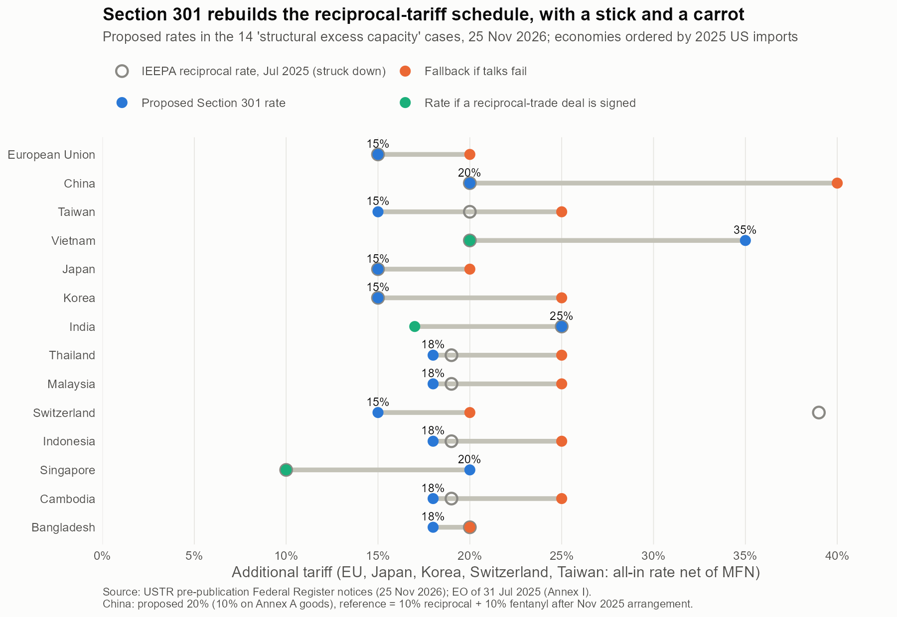
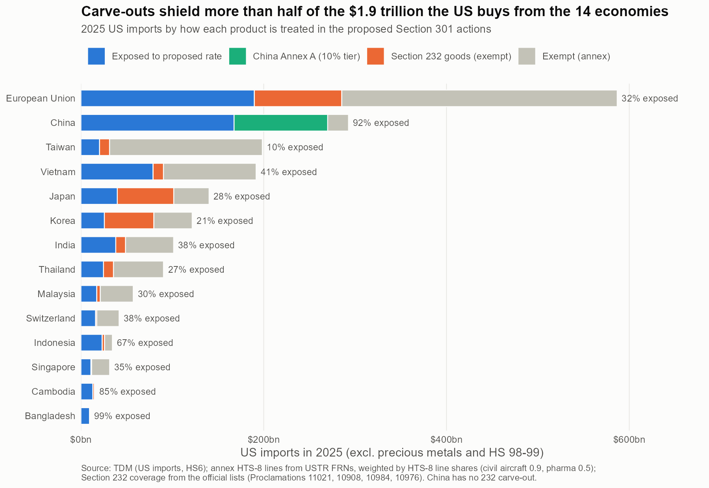

**Topic:** Section 301 "structural excess capacity" determinations, the legal rebuild of the reciprocal tariffs.

Eight and a half months ago USTR launched sixteen Section 301 investigations ([Day 414](../2026-03-11-trump-trade-war-diary-day-414/index.qmd)). Today USTR Jamieson Greer [announced](https://ustr.gov/about/policy-offices/press-office/press-releases/2026/november/ustr-makes-determinations-and-proposes-actions-14-section-301-investigations-relating-structural) determinations for 14 of the 16 economies. In every one of them, the acts, policies and practices "relating to structural excess capacity and production in manufacturing sectors" are found to be **unreasonable and to burden or restrict U.S. commerce**. That makes them actionable under Section 301(b).

Mexico and Norway got no determination "at this time". Mexico is the largest single-country supplier of US imports ($517bn in 2025), so leaving it out is a political choice, not an analytical one. The process drew more than 1,070 written comments, and nearly 140 witnesses testified at the hearings of May 5–8, 2026.

Greer's framing: trading partners pursued "industrial strategies built on targeting manufacturing, wage and labor suppression...". The President therefore proposes action "to bring about the elimination of these unfair acts, policies, and practices."

The press release gives only the headline rates. The real content is in the 14 pre-publication Federal Register notices (FRNs) and their product annexes. I downloaded all of them and went through them line by line. The numbers below are my own calculations from the FRNs and 2025 US trade data.

## What is proposed

Each action is a tariff of "up to" X% on **all goods** from the economy, minus a list of exemptions. Each FRN also contains something the press release leaves out: an **alternative rate**.

- **Countries with a deal:** the alternative is a higher *fallback* rate, which applies if "ongoing consultations and existing commitments are unsatisfactory".
- **Countries without a deal (India, Vietnam, Singapore):** it works the other way round. The headline rate is the stick. A lower rate applies "were [the country] to reach an Agreement on Reciprocal Trade ... responsive to the determinations".

| Economy | US imports 2025 (\$bn) | Proposed rate (%) | Alternative (%) | IEEPA rate, Jul 2025 (%) | Exempt: annex / S232 (% of imports) | Exposed to proposed rate (\$bn) | Sectors singled out |
|---|---:|---:|---:|---:|---:|---:|---|
| European Union | 586.8 | 15\* | 20\* (fallback) | 15 | 51 / 16 | 189.6 | autos, chemicals, pharmaceuticals |
| China | 292.5 | 20 (10 on Annex A) | 40 (fallback) | 20† | 8 / – | 270.0‡ | 22 sectors: steel, aluminium, EVs, batteries, chips, solar, ships, robotics, textiles... |
| Taiwan | 198.4 | 15\* | 25 (fallback) | 20 | 84 / 6 | 20.3 | electronics, semiconductors, telecoms |
| Vietnam | 191.7 | 35 | 20 (if deal) | 20 | 53 / 6 | 78.8 | textiles, apparel, footwear, shipbuilding, cement, ICT |
| Japan | 140.2 | 15\* | 20\* (fallback) | 15 | 28 / 44 | 39.7 | autos, steel, semiconductors, optical fibre |
| Korea | 121.7 | 15\* | 25\* (fallback) | 15 | 35 / 44 | 25.6 | autos, semiconductors, petrochemicals |
| India | 101.4 | 25 | 17 (if deal) | 25 | 52 / 11 | 38.1 | pharma, medical devices, steel, solar, ICT |
| Thailand | 90.3 | 18 | 25 (fallback) | 19 | 61 / 12 | 24.6 | electronics, autos, machinery, electrical equipment |
| Malaysia | 57.2 | 18 | 25 (fallback) | 19 | 63 / 7 | 17.2 | ICT, autos |
| Switzerland | 41.7 | 15\* | 20\* (fallback) | 39 | 59 / 3 | 15.9 | pharmaceuticals, steel, chemicals |
| Indonesia | 34.4 | 18 | 25 (fallback) | 19 | 25 / 8 | 23.1 | textiles, apparel, mining & metals, renewables |
| Singapore | 31.4 | 20 | 10 (if deal) | 10 | 63 / 2 | 10.8 | electronics, semiconductors, health, petrochemicals |
| Cambodia | 15.1 | 18 | 25 (fallback) | 19 | 4 / 11 | 12.9 | apparel, solar, tyres |
| Bangladesh | 9.3 | 18 | 20 (fallback) | 20 | 0 / 0 | 9.3 | ready-made garments |
| **Total, 14 economies** | **1,912.2** | | | | | **775.9** | |

: The 14 proposed Section 301 actions at a glance.

\* All-in rate, "net of MFN rates and existing Section 301 tariffs" (as in the 15% EU/Japan/Korea deals). The other rates are additional to MFN and net of existing Section 301 duties only. Taiwan's 25% fallback is net of Section 301 only. † China: 10% reciprocal + 10% fentanyl after the Kuala Lumpur arrangement (EO 14358, Nov 2025). ‡ China: $167.5bn at the 20% rate plus $102.5bn of Annex A goods at 10%.

*Sources:* USTR pre-publication FRNs (25 Nov 2026); EO of 31 Jul 2025, Annex I. US imports are from TDM (HS6, 2025), excluding precious metals (7106, 7108, 7110, 7112, 7115) and special provisions (ch. 98–99). Annex exemptions are weighted by HTS-8 line shares within each HS6. Section 232 coverage comes from the official product lists.

{fig-alt="Dot chart of the 14 economies showing the proposed Section 301 rate, the fallback or deal rate, and the July 2025 IEEPA rate. Most proposed rates sit exactly on the old IEEPA deal rates: 15% for the EU, Japan, Korea and Taiwan, 20% for China, 18% for the ASEAN partners."}

The chart makes the main point clear. **The "remedies" are the reciprocal-tariff deals, moved to a new legal basis.**

- **EU, Japan and Korea** get 15% all-in, exactly their 2025 framework rate.
- **Switzerland** gets 15%. That is its November 2025 framework rate, not the punitive 39%.
- **Taiwan** gets 15%, per the February 2026 Agreement on Reciprocal Trade.
- **China** gets 20%. The FRN says explicitly that this "accounts for the commitments and 20 percent tariff rate announced as part of the Kuala Lumpur Joint Arrangement".
- **Thailand, Malaysia, Indonesia and Cambodia** all have deals or frameworks, and they get 18%. That is one point below their old 19%, a small sweetener for having signed.

Each FRN footnotes the relevant bilateral agreement. The diagnosis is supposedly the same "structural excess capacity" everywhere, yet the rate follows deal status, not any measure of the harm. A Section 301 remedy is supposed to be set at whatever level gets the practice eliminated. These rates simply repeat the price agreed in the last negotiation.

## What is exempted

The exemption annexes are close to identical across economies:

- **A common core of 2,114 HTS-8 lines** appears unchanged in the annexes for Japan, Korea, India, Singapore, Thailand and Vietnam. China's **Annex A is exactly the same list**, but for China it is a 10% tier, not an exemption.
  - The EU gets 44 extra lines.
  - Countries with signed agreements (Bangladesh, Cambodia, Indonesia, Malaysia, Taiwan, Switzerland) get 86–156 extra lines. These are mostly agricultural products and inputs from their agreements.
- **The core list is essentially the old IEEPA Annex II plus later additions.** It covers:
  - pharmaceuticals and their chemical inputs (641 lines in HS29 alone, roughly 700 lines restricted to pharmaceutical use);
  - civil aircraft and parts (roughly 550 lines restricted to civil aircraft);
  - energy (HS27), critical minerals and metals, and gold;
  - tropical agricultural products (coffee, spices, fruit, beef);
  - **the electronics exemption of April 2025:** computers (8471), smartphones (8517.13), network equipment and chips.
- **All economies except China also get a carve-out for goods already under Section 232.** These are steel, aluminium, copper, passenger vehicles and light trucks, medium and heavy trucks and their parts, wood products, patented pharmaceuticals and semiconductors. **The China FRN contains no Section 232 carve-out.**
- **China's Annex B (77 lines, fully exempt)** comes from the U.S.-China Board of Trade "30-for-30" list: toys (9503, $9bn), fireworks, plastic tableware, bed and table linen, electric blankets.

{fig-alt="Stacked bar chart of 2025 US imports from each of the 14 economies, split into goods exposed to the proposed rate, China's 10% Annex A tier, Section 232 goods and annex-exempt goods. Exposure ranges from 10% for Taiwan to 92% for China and 99% for Bangladesh."}

A few numbers from 2025 US imports:

- **The 14 economies supplied $1.91 trillion**, about 61% of US goods imports (excluding precious metals). Only about **$776bn (41%)** would face the proposed rates. The rest is exempt, either through the annex (mostly pharma and electronics) or through Section 232.
- **Exposure varies hugely.**
  - **Taiwan: 10%.** Computers, servers and their parts are exempt, $132bn in 8471/8473 alone.
  - **Korea and Japan: 21–28%.** Autos and other goods are already under Section 232.
  - **China 92%, Cambodia 85% and Bangladesh 99%.** Garment exporters have nothing in the annex.
- **China's 10% tier covers about $100bn.** It is led by smartphones ($23.5bn), **lithium-ion batteries** ($11.7bn) and laptops ($8.6bn). The FRN names batteries as one of China's excess-capacity sectors, yet batteries land in the *low* tier.
- **The extra duty is about $71bn a year at 2025 volumes:** $28bn China, $18bn Vietnam, $9bn EU. This is far less than the headline rates suggest, because the new duty only tops up the forced-labour Section 301 that has applied to 60 economies since 24 July 2026. Once trade responds to the new tariffs, extra US tariff revenue is closer to **$34bn**.

## Procedure and timing

- **Comments and hearings.** Written comments and requests to appear are due **January 5, 2027**. Hearings start **January 25, 2027** at the USITC. Comments go to separate dockets for each economy (e.g. China USTR-2026-0278, EU USTR-2026-0730). Requests to appear go to USTR-2026-0741.
- **No effective date yet.** Realistically, the earliest implementation is Q1–Q2 2027.
- **An EU sunset.** For the EU, USTR proposes that the action **terminate on December 1, 2028**. This matches the EU's own Regulation (EU) 2026/1455, which grants tariff concessions on US goods from July 1, 2026 to December 31, 2029. The deal is being codified on both sides, with sunset dates attached.
- **China's rate stacks on another 301.** China's 20% is net of the duty from yet another Section 301 action, on China's failure to prohibit imports of goods made with forced labour (91 FR 47318, July 28, 2026). China declined USTR's request for consultations.
- **A plurilateral option.** USTR also asks for comments on whether to negotiate a **plurilateral agreement on structural excess capacity, including with China**. This is the only multilateral element in the whole exercise.

## My observations

1. **This is the Supreme Court workaround.** On February 20 the IEEPA tariffs were struck down. GTA's modelled trade-weighted US tariff (top 1,000 flows) fell from about 10% in December 2025 to 5.8% on the day of the ruling. It stands at about 8.7% today (GTA US Tariff Estimates, model snapshot 2026-10-23). These 14 actions would rebuild most of the reciprocal-tariff wall on a statute that courts have treated with much more deference than IEEPA.
   - In *HMTX Industries v. United States* (25 Sep 2025), the Federal Circuit upheld the 2018 China Lists 3 and 4A. A cert petition (No. 25-1012) followed in February 2026.
   - Section 301 requires an investigation, a determination, notice and comment. The administration has now done all of that.
2. **"Excess capacity" has been stretched to mean "anything we don't like about your macroeconomy".** The list of "unreasonable" practices includes:
   - Japan's *household investment promotion*;
   - Singapore's *savings promotion policies that suppress domestic consumption*;
   - Switzerland's currency;
   - financial repression almost everywhere;
   - Taiwan's past purchases of Russian feedstock;
   - for all of them, "failure to address global excess capacity", i.e. buying Chinese inputs or hosting Chinese FDI.

   This is a saving-investment imbalance argument relabelled as an unfair trade practice. Comments on methodology were noted and set aside. They argued, for example, that low capacity utilisation can reflect the business cycle, and that trade surpluses reflect saving patterns.
3. **The remedy does not target the sectors in the diagnosis.** The FRNs name steel, autos, semiconductors and pharma. Those are exactly the goods that are *exempted*, because they sit under Section 232 or in the annex. What is actually taxed is everything else: apparel from Bangladesh and Cambodia, furniture and footwear from Vietnam, machinery and consumer goods from Europe. The cost falls on garment workers in Dhaka and on US consumers, not on Chinese or Korean steel mills.
4. **It is a negotiating instrument with a legal wrapper.** The stick-and-carrot structure shows the real objective: lock in the 2025–26 bilateral deals and keep leverage over them.
   - The sticks are fallback rates of up to 40% for China and 25% for Korea and Taiwan.
   - The carrots are deal rates of 17% for India, 20% for Vietnam and 10% for Singapore.
   - Korea's 25% fallback matches the rate Trump threatened in January, when the Korean legislature had not passed the deal ([Day 371](../2026-01-27-trump-trade-war-diary-day-371/index.qmd)).
5. **The WTO dimension is unchanged.** Country-specific tariffs on all goods break MFN just as the IEEPA tariffs did. A WTO panel already found the 2018 China 301 tariffs inconsistent with GATT Articles I and II (DS543, 15 Sep 2020). The US appealed that ruling into the void left by the non-functioning Appellate Body, and nobody expects the WTO to matter here. The more interesting question is Mexico. Excluding the largest bilateral exporter while hitting Cambodia at 18% says a lot about where the USMCA review is.

The comment period runs over Christmas. Expect a flood of product-by-product exclusion requests. That is exactly how the deals will be renegotiated in 2027.

## The UK angle

The UK is not on the list. That is good news for British exporters, but it comes with a catch.

- **The UK already pays 10% under the forced-labour Section 301.** The new rates are *net of existing Section 301 duties*, so the excess-capacity action tops each target up to its headline rate and leaves the UK where it is.
- **That reverses the UK's position against the EU.** On a typical covered product, the UK goes from paying 2pp more than EU exporters to paying 3pp less.

I ran the proposal through a general-equilibrium trade model to see who gains and who loses: the US, China, the EU and the UK. I also looked at which UK product groups are likely to benefit. The results are in a companion post: [Section 301 "excess capacity" tariffs: the US, China and Vietnam lose, the UK gains, if it stays outside](../2026-11-25-section-301-excess-capacity-uk/index.qmd).
